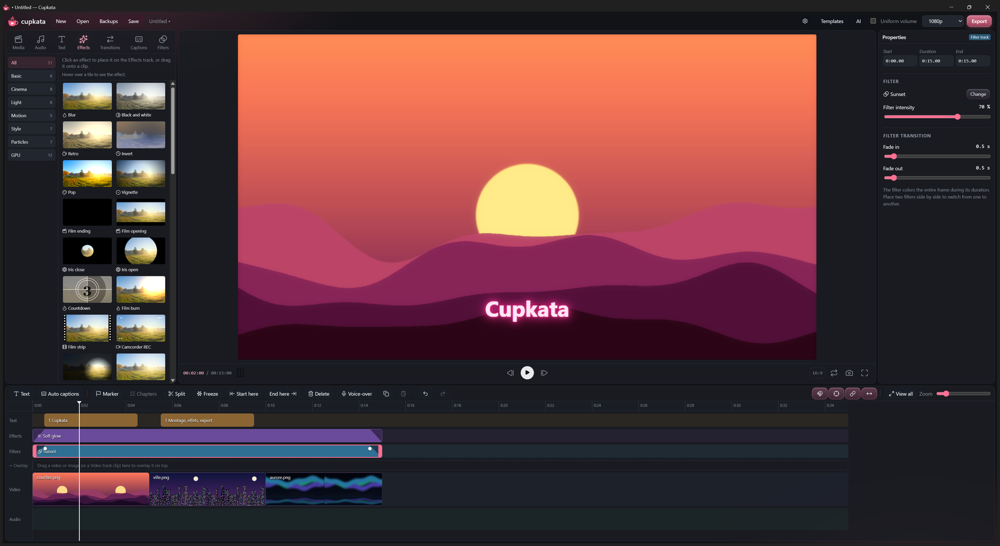

# Cupkata

A desktop video editor for Windows, built with Electron, React and FFmpeg.
The interface is in English by default, with French available in Settings.



## Principle

**The preview matches the export.** Every setting you see in the window is computed with the same formulas
as the FFmpeg export, or with the same shader through the shared WebGL engine (`src/gpu`).
When a process cannot be replayed live (stabilization, green screen, voice cleanup, voice effects),
Cupkata creates a processed copy of the file, so the preview plays exactly what the export will use.

## Features

- **Editing**: multi-track timeline (video, overlays, audio, text, effects, filters), cutting, markers, chapters,
  text-based editing, beat sync to the music, keyframes with easing curves, speed ramps.
- **Picture**: 132 color filters (LUTs) and adjustment layers, about forty effects (including GPU effects),
  39 transitions, auto reframe, stabilization, green screen, shapes, stickers.
- **Text**: animated titles, automatic captions with local Whisper, word by word.
- **Audio**: volume, fades, ducking, waveforms, loudness normalization (loudnorm), voice cleanup, voice effects,
  56 sound effects generated with Stable Audio 3 Small SFX.
- **Export**: H.264, H.265 and AV1, NVENC encoding with CPU fallback, presets, short format, clip export.
- **Projects**: autosave, backups, templates, proxies for large files.
- **AI control**: local token-protected API, enabled with the **AI** button (see `ai/GUIDE.md`
  and the MCP server `ai/cupkata-mcp.cjs`).

## Install

Download `Cupkata-Setup` from the **Releases** tab. The app is not code-signed, so Windows SmartScreen
may show "Windows protected your PC"; click **More info**, then **Run anyway**.

## Run from source

Requirements: Windows, Node.js. FFmpeg and FFprobe are provided by `ffmpeg-static` and `ffprobe-static`.

```sh
npm install
npm start        # builds the interface, then opens the app
npm run dev      # development mode with hot reload (Vite + Electron)
npm test         # Vitest tests, including real FFmpeg exports
npm run dist     # NSIS installer and portable build in release/
```

`Lancer Cupkata.bat` opens the app without a terminal.

## Project layout

| Folder | Contents |
| --- | --- |
| `src/` | React interface: timeline, panels, preview, effects, filters, transitions, translations (`i18n.js`). |
| `src/gpu/` | WebGL engine shared by the preview and the export. |
| `electron/` | Main process: FFmpeg export (`media.cjs`), encoders, proxies, transcription, backups, AI API. |
| `shared/` | Data used by both sides: effects, filters, voice effects, sounds, English dictionary (`en.json`). |
| `ai/` | Guide and MCP server to control Cupkata from an AI (in French). |
| `tests/` | Vitest tests. |
| `build/`, `public/` | Icons and static files. |

## Translations

Every visible string goes through `T('French text', ...values)`. The French text is the key, the English
translation lives in `shared/en.json`, and `{0}`, `{1}`… mark the values. A test checks that every string is translated.

## Third-party code and licenses

Third-party code is only under permissive licenses (MIT, Apache, BSD, ISC) and credited in
[`THIRD_PARTY_NOTICES.md`](THIRD_PARTY_NOTICES.md). The sound effects fall under the Stability AI Community
License ("Powered by Stability AI"). The sample photos come from Poly Haven (CC0).

FFmpeg, bundled with the app, is licensed under the GPL v3: see the FFmpeg section of `THIRD_PARTY_NOTICES.md`.

Cupkata is released under the MIT License (see [`LICENSE`](LICENSE)).
